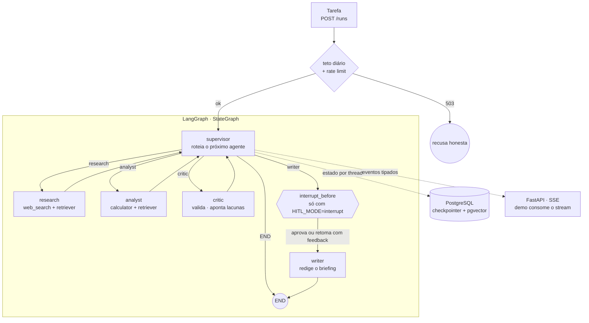

# Arquitetura

Pauta decompõe uma pergunta analítica em etapas, delega cada etapa a um agente
especializado, valida o resultado com um crítico e redige um briefing. O grafo
tem 5 nós. Não vai crescer sem número de eval que justifique.

## O grafo

O supervisor decide o próximo passo a cada ciclo. O crítico pode devolver o
trabalho para research ou analyst apontando a lacuna. O writer só roda depois de
crítico aprovado, ou do limite de iterações, ou do estouro de orçamento. Com
`HITL_MODE=interrupt`, o grafo congela antes do writer e espera o humano. O
feedback do revisor entra no prompt da redação.

## Decisões

### ADR 001: supervisor com roteamento dinâmico, não pipeline fixo

**Contexto.** Tarefas analíticas variam. Umas precisam de três ciclos de pesquisa,
outras vão direto para cálculo.

**Decisão.** O supervisor é um LLM com output estruturado que escolhe o próximo
agente e justifica a escolha em uma frase.

**Consequência.** Uma chamada de LLM a mais por ciclo. Em troca, o grafo se adapta
à tarefa em vez de gastar etapas inúteis. A justificativa vai no stream de eventos.

### ADR 002: crítico com loop finito

**Contexto.** Validação cruzada separa rascunho de briefing. Loop de LLM sem teto é
conta de API sem teto.

**Decisão.** `MAX_CRITIC_LOOPS = 2`. Depois disso o writer redige com as ressalvas
registradas no próprio texto.

**Consequência.** O relatório pode sair dizendo "não foi possível validar X". Isso é
o comportamento desejado, não uma falha.

### ADR 003: memória via checkpointer do LangGraph, não banco caseiro

**Contexto.** O sistema precisa retomar execução por thread e pausar para um humano.

**Decisão.** `PostgresSaver` oficial em produção, `MemorySaver` em teste.

**Consequência.** Checkpoint por `thread_id`, retomada e o mecanismo de
interrupt/resume vêm do framework. O que o checkpointer faz por nós está declarado
no README, porque saber o que o framework abstrai importa tanto quanto usá-lo.

### ADR 004: orçamento como cidadão de primeira classe, em três camadas

**Contexto.** Agentes multiplicam chamadas. Uma tarefa ruim pode custar 100 vezes o
esperado, e uma demo pública pode custar mais que isso.

**Decisão.** Três camadas. Camada 1: contador de tokens no estado, checado no
supervisor, estourou vai direto para o writer. Camada 2: teto global diário em
Postgres, checado no handler HTTP, estourou devolve 503. Camada 3: rate limit por
IP na demo pública.

**Consequência.** O custo aparece no payload de resposta e no log desde o primeiro
commit. O 503 traz mensagem honesta, com instrução de clonar e rodar local.

**Revisão de 2026-09-28: reserva do writer.** Medido com busca `ddgs`, uma run
fechou em 74.905 tokens contra o teto de 60.000. Dois furos na camada 1. O writer
rodava depois do teto, sem reserva, e gastou 13.685. O research parava olhando
só o que já tinha gastado, e a extração final ainda vinha depois. Agora
`WRITER_RESERVE_TOKENS` separa uma parte do teto para o writer: supervisor,
research e analyst trabalham até `BUDGET_TOKENS_PER_RUN - WRITER_RESERVE_TOKENS`.
Dentro do nó, as rodadas de tool param quando o gasto mais uma chamada do tamanho
da última não cabe mais, porque o histórico só cresce e a extração custa pelo
menos isso. Continua sendo teto mole: o critic e a chamada em curso não são
interrompidos, e o writer pode gastar mais que a reserva. A reserva de 15.000 é
estimativa sobre uma medição, n=1.

### ADR 005: vetores em pgvector, não em Chroma embedded

**Contexto.** O compose já sobe Postgres para o checkpointer. Adicionar Chroma
introduziria um segundo mecanismo de persistência no mesmo diagrama.

**Opções.** Chroma embedded tem setup zero e isola o índice do banco de estado, ao
custo de mais um volume no compose. pgvector reusa o Postgres que já existe, ao
custo de habilitar a extensão e escrever a query de similaridade.

**Decisão.** pgvector, via `langchain-postgres`. A imagem do compose passa a ser
`pgvector/pgvector`, e a extensão é criada na inicialização do banco.

**Consequência.** Um storage no diagrama, não dois. O teste do retriever passa a
precisar de Postgres, então ele fica marcado e é pulado quando não há banco. O
embedding é `text-embedding-3-small`, declarado em `EMBEDDING_MODEL`, nunca
implícito no código, e vem de um gateway próprio: o gateway de chat não serve
embedding, como a ADR 007 registra.

### ADR 006: recuperação explícita, nunca automática

**Contexto.** `POST /runs` responde 201 na hora e executa em background. Se o
processo cair, a run fica com checkpoint válido e sem executor.

**Decisão.** No startup, a app varre threads em estado não terminal e as marca como
`orphaned`. Não retoma sozinha. A retomada é um POST explícito.

**Consequência.** `orphaned` existe no contrato da API e aparece em
`GET /runs?status=orphaned`. Religar o servidor não gasta token de ninguém.

### ADR 007: modelo é configuração por papel, não constante global

**Contexto.** Research e writer fazem recuperação e redação. Supervisor e crítico
fazem raciocínio. Modelo barato em tudo sabota o experimento central do projeto,
porque crítico fraco tende a carimbar `verdict: ok`.

**Decisão.** Toda instanciação passa por `get_model(role)`, com `init_chat_model` e
variáveis de ambiente. Nenhum default no código. O acesso é por gateway que fala o
protocolo da OpenAI. O de chat é o Model Studio da Alibaba, em `CHAT_BASE_URL`, e
serve três casas: Qwen, GLM e DeepSeek.

**Consequência.** Trocar de modelo é editar `.env`. O eval ganha um terceiro eixo,
crítico barato contra crítico melhor. O juiz de outro provider, que a metodologia
exige para evitar auto-preferência, é uma troca de id na mesma chave, porque as três
casas estão no mesmo gateway. O `model_provider` é passado explícito como `openai`
porque o id deste gateway é nu, sem a casa de origem no nome (`qwen3.8-flash`,
`glm-5.3`), então não há prefixo de onde o LangChain deduzir o provider. O preço fica
na tabela do gateway, e é esse o número que vale para o eval.

**O que este gateway não faz.** Embedding. Medido em 2026-09-25: a lista de
`/models` traz 11 modelos de texto, 2 de imagem e 2 de áudio, e nenhum de embedding;
`/embeddings` recusa `text-embedding-v4`, `text-embedding-v3` e
`text-embedding-3-small`. Vale a ressalva de método: naquele gateway o 404 é também
como um modelo de chat fora do plano é recusado, então o que está medido é "não está
neste plano", não "a rota não existe". Por isso o embedding tem gateway e chave
próprios, em `EMBEDDING_BASE_URL` e `EMBEDDING_API_KEY`. São duas chaves para manter
o índice do corpus independente do plano de chat.

### ADR 008: provedor de busca é configuração, não uma constante

**Contexto.** A busca web era a Tavily e dependia de `TAVILY_API_KEY`. Em
2026-09-27 a cota da chave acabou, e as 11 tarefas do golden set com
`needs_research` perderam a fonte externa. O código já rodava sem busca:
`research_tools()` só montava a tool quando havia chave. Rodar sem busca é
possível e o README já declarava como limitação. O problema é o eval, que
precisa da busca nas tarefas externas.

**Decisão.** `SEARCH_PROVIDER` escolhe entre `tavily` e `ddgs`, com default
`ddgs`. O `ddgs` é metasearch sem chave e sem custo, e a assinatura dele está
confirmada na documentação do PyPI. Os dois provedores saem com a mesma tool
`web_search`, o mesmo argumento `query` e o mesmo formato de saída
`title/href/body`. Nome, argumento e payload unificados: é o que torna dois
artefatos comparáveis. `SEARCH_REGION` fecha em `br-pt`, porque o golden set é
em português e o default do pacote é `us-en`. `SEARCH_BACKEND` fecha em
`Literal`, porque um engine digitado errado só apareceria dentro da run.

**Consequência.** A busca deixa de ser exceção e passa a ser regra, porque o
`ddgs` não exige chave. O estouro de orçamento de 80.728 tokens contra o teto
de 60.000, medido numa tarefa com busca em 2026-09-08, sai de acidente e vira
comportamento esperado até o guardrail ser medido de novo.

**Exposição assumida.** A página do `ddgs` no PyPI termina com "Disclaimer:
This library is for educational purposes only." O autor limita o uso, e este
repositório roda eval e publica número por cima dele. O escape é
`SEARCH_PROVIDER=tavily`, que não exige commit. Medido em 2026-09-28: o `timeout` do
`DDGS` vale por requisição HTTP, não pela chamada, e uma chamada com `timeout=10`
levou 31,2s. No piloto da matriz, 20 de 25 runs morreram no timeout de 240s do
nó, com a busca consumindo o tempo. A tool agora impõe `WEB_SEARCH_TIMEOUT_S`
à chamada inteira com `asyncio.wait_for`, e o estouro vira `ToolMessage` de erro. Outro risco medido no lock: o
`ddgs` declara `primp>=1.3.1` sem teto superior, e o lock resolveu
`primp 2.0.1`, dois majors acima do que o autor testou. A superfície usada
pelo `ddgs` passou em smoke, e nenhum teste roda busca real.

**O que não muda.** A ADR 007 continua valendo: nenhum modelo hardcoded, todo
LLM vem de `get_model(role)`. A degradação em falha de busca continua vindo do
`run_tools`, que emite evento `error` e devolve `ToolMessage` de erro. A tool
não captura exceção, de propósito: tratar dentro dela esconderia a falha.

## APIs do LangGraph que este projeto usa

Verificadas contra `langgraph 1.2.11`, a versão do lock. Se o pin subir, confira de
novo antes de confiar nesta tabela.

| API | Assinatura real | Uso aqui |
|---|---|---|
| `StateGraph.add_node` | `add_node(node, action=None, *, retry_policy=None, timeout=None, error_handler=None, defer=False, ...)` | timeout e retry por nó, sem wrapper manual |
| `timeout` por nó | só aceito em nó `async`; nó síncrono é recusado no `compile()` | por isso os cinco nós são `async def` |
| `RetryPolicy` | `NamedTuple(initial_interval, backoff_factor, max_interval, max_attempts, jitter, retry_on)` | `max_attempts` e um `retry_on` próprio |
| `RunControl` | `langgraph.runtime.RunControl`, com `request_drain(reason)` e `drain_requested` | drain cooperativo; o `ainvoke` recebe `control=` e levanta `GraphDrained` |
| `interrupt_before` | argumento de `compile()`, lista de nós | congela antes do writer quando `HITL_MODE=interrupt` |
| `CompiledStateGraph.stream` | aceita `control=`, `durability=` e `version="v1" \| "v2"` | stream tipado que vira SSE |

No Windows, o `psycopg` em modo assíncrono recusa o `ProactorEventLoop`, que é o
loop padrão da plataforma. Quem abre o loop escolhe a fábrica certa, via
`memory.checkpointer.loop_factory`. Uma biblioteca não troca a policy global do
processo por conta própria, então isso é decisão do ponto de entrada: o runner do
eval, a app da API e o hook `pytest_asyncio_loop_factories` nos testes.

Um `RunControl` é por run. Reusar um que já foi drenado deixa a run seguinte parada
antes do primeiro superstep, e há teste para isso.

O `default_retry_on` do LangGraph retenta 5xx e recusa `ValueError` e `TypeError`.
Ele não retenta 429. Como rate limit precisa ser retentado e erro de validação de
schema não, este projeto passa o próprio predicado em `retry_on`.
